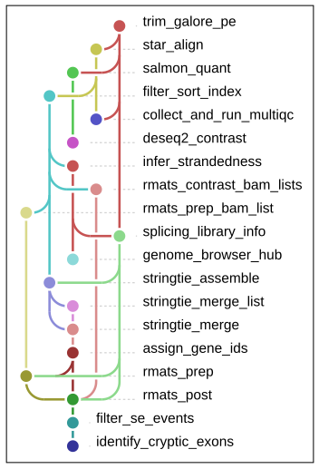

# RNA-seq pre-processing, expression and splicing pipeline

A Snakemake workflow that takes raw RNA-seq reads (local FASTQs or SRA
accessions) through trimming, alignment, transcript quantification, QC, and
optionally through genome-browser track generation, differential gene
expression, and differential splicing with novel-isoform annotation.

Built for a PBS/Torque HPC cluster, but the workflow itself is
scheduler-agnostic — cluster specifics live entirely in a Snakemake profile.

<p align="center">
  
</p>

---

## What it does

| Stage | Tools | Always runs? |
|---|---|---|
| SRA download | `fastq-dump` | Only for samples given an SRA accession |
| Read trimming + FastQC | Trim Galore, FastQC | Yes |
| Genome alignment | STAR | Yes |
| Unique-read filtering, sorting, indexing | samtools | Yes |
| Transcript quantification | Salmon | Yes |
| Aggregate QC report | MultiQC | Yes |
| Strandedness inference | RSeQC `infer_experiment.py` | When bigwig or splicing is enabled |
| Strand-split bigwigs + UCSC track hub | pysam, bedtools, `bedGraphToBigWig` | Per sample, via `generate_bw` |
| Differential gene expression | tximport, DESeq2 | Via `dge.enabled` |
| Transcript assembly + differential splicing | StringTie, rMATS | Via `splicing.enabled` |
| Cryptic/annotated exon calling | custom scripts | With splicing |

Single-end and paired-end samples are handled automatically, as are mixtures of
human and mouse samples within a run (except in the splicing branch, which
requires one species — see [Configuration](docs/CONFIGURATION.md)).

## Documentation

- **[Installation](docs/INSTALLATION.md)** — dependencies, conda environments, cluster profile
- **[Configuration](docs/CONFIGURATION.md)** — every tunable option, and what is deliberately fixed
- **[Usage](docs/USAGE.md)** — running, testing, resuming, common commands
- **[Outputs](docs/OUTPUTS.md)** — what gets written where
- **[Troubleshooting](docs/TROUBLESHOOTING.md)** — failure modes seen in practice

## Quick start

```bash
# 1. clone
git clone https://github.com/kennyrebelo/RNAseq_pre_processing.git
cd RNAseq_pre_processing

# 2. environment holding Snakemake itself
conda create -n snakemake -c conda-forge -c bioconda snakemake mamba
conda activate snakemake

# 3. describe your data
#    edit samples.tsv, experimental_design.tsv, config_RNAseq_pipeline.yaml
#    (the versions shipped here are annotated templates with
#     /path/to/... placeholders and one example of every input type)

# 4. install the cluster profile, if running on PBS/Torque
cp -r profiles/pbs-torque ~/.config/snakemake/
chmod +x ~/.config/snakemake/pbs-torque/{pbs-submit.py,pbs-status.py,pbs-jobscript.sh}
#    then edit the conda path at the top of pbs-jobscript.sh -- see
#    profiles/pbs-torque/README.md

# 5. check the plan without running anything
snakemake --profile pbs-torque --use-conda -n

# 6. run
snakemake --profile pbs-torque --use-conda
```

Not on PBS? Drop `--profile` and give `--cores` instead — the workflow itself
contains no scheduler-specific code. See
[profiles/pbs-torque/README.md](profiles/pbs-torque/README.md) for adapting to
SLURM, SGE or LSF.

The three tool environments (`environment_RNAseq.yaml`,
`environment_DESeq2.yaml`, `environment_rMATS.yaml`) are built automatically by
`--use-conda` on first run. Expect 15–30 minutes for that build.

## Directory structure

Everything below lives in one directory, and the workflow is run from it.
The `rules/` and `scripts/` directory names are referenced by `Snakefile` and
`rules/common.smk`, so they cannot be renamed without editing those two files.

```
<project>/
├── Snakefile                          # configfile, rule all, module includes
├── config_RNAseq_pipeline.yaml        # all tunable settings
├── samples.tsv                        # one row per sample
├── experimental_design.tsv            # group + contrast definitions
│
├── environment_RNAseq.yaml            # main toolchain
├── environment_DESeq2.yaml            # R / Bioconductor, DGE only
├── environment_rMATS.yaml             # StringTie + rMATS, splicing only
│
├── rules/
│   ├── common.smk                     # config, sample sheet, helpers  (included first)
│   ├── preprocessing.smk              # SRA download, Trim Galore
│   ├── alignment.smk                  # STAR, unique filtering, Salmon
│   ├── qc.smk                         # MultiQC
│   ├── bigwig.smk                     # strandedness, bigwigs, track hub
│   ├── dge.smk                        # DESeq2
│   └── splicing.smk                   # StringTie + rMATS
│
├── profiles/
│   └── pbs-torque/                    # example PBS/Torque profile
│       ├── config.yaml                # cluster command, job limits, resources
│       ├── pbs-submit.py              # builds and issues qsub
│       ├── pbs-status.py              # reports job state to Snakemake
│       ├── pbs-jobscript.sh           # per-job wrapper  ← must be edited
│       └── README.md
│
├── scripts/
│   ├── split_strands.py
│   ├── make_bigwig.py
│   ├── make_genome_browser_hub.py
│   ├── deseq2_contrast.R
│   ├── splicing_library_info.py
│   ├── assign_gene_ids.py
│   ├── filter_se_events.py
│   └── identify_cryptic_exons.py
│
└── docs/
    ├── INSTALLATION.md
    ├── CONFIGURATION.md
    ├── USAGE.md
    ├── OUTPUTS.md
    ├── TROUBLESHOOTING.md
    └── images/pipeline_rulegraph.svg
```

`samples.tsv`, `experimental_design.tsv` and `config_RNAseq_pipeline.yaml` ship
as annotated templates: every path is a `/path/to/...` placeholder, and the
sample sheet includes one row of each input type (paired-end, single-end, SRA
accession, and a second species) with `generate_bw` set both ways.

`profiles/` is only needed on a cluster. It is copied to
`~/.config/snakemake/` rather than used in place, since that is where Snakemake
looks up a profile by name.

Generated at runtime (not tracked in git):

```
├── processed/                         # or whatever pre_processing_dir points to
│   ├── trimmed_reads/  star_alignment/  salmon_quant/
│   ├── bigwig/  genome_browser/
│   └── logs/<rule>/<sample>.log
├── QC/multiqc_report.html
├── DGE/
├── splicing/
├── logs/cluster/                      # scheduler stdout/stderr
└── .snakemake/                        # Snakemake state and built conda envs
```

## Design notes

**Three separate conda environments.** The R/Bioconductor stack and the
StringTie/rMATS stack are isolated from the main toolchain so that changing one
does not force the solver to re-resolve the others. Each pins
`sysroot_linux-64=2.17` to keep the solver on builds that run against older
cluster glibc, and uses `nodefaults` to keep stale `pkgs/main` and `pkgs/r`
builds out of the solve.

**Library type is inferred, not declared.** RSeQC's `infer_experiment.py`
determines strandedness per sample, which then sets StringTie's `--rf`/`--fr`
flag and rMATS's `--libType`. If samples in a splicing run disagree, the
pipeline stops rather than picking one — an inverted library type silently
flips every junction's strand assignment.

**Checkpoints where output is unknown ahead of time.** SRA downloads may
produce one or two FASTQs, and strandedness is only known after alignment. Both
are Snakemake `checkpoint`s, so the DAG is re-evaluated once they complete.

**Failure is loud.** Every rule writes a `log:`, which survives job failure even
though Snakemake deletes failed outputs. Sample sheet and design file problems
are caught at DAG-build time rather than mid-run on a compute node.

## Citation

If you use this pipeline, please cite the underlying tools: Snakemake,
Trim Galore, Cutadapt, FastQC, STAR, Salmon, samtools, MultiQC, RSeQC,
bedtools, DESeq2, tximport, StringTie, and rMATS.
